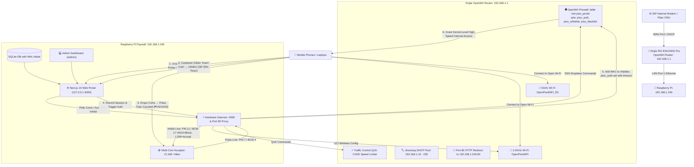

# 📶 OpenPisoWiFi

<div align="center">


-red?style=for-the-badge&logo=openwrt&logoColor=white)


**Next-Generation Full-Stack Piso Wi-Fi Vending System & Captive Paywall**  
*Powered by **Ruijie RG-EW1200G Pro (OpenWrt Gigabit Router)** + **Raspberry Pi Paywall Controller** + **OpenPiso Shield***

[Landing Page](https://openpisowifi.nicolei.games) • [OpenPiso Shield](#-openpiso-shield--security-hardening) • [Multi-Architecture Guide](docs/MULTI_ARCHITECTURE_GUIDE.md) • [Features](#-key-features) • [Network Architecture](#-network-architecture--addressing-scheme) • [Hardware Wiring](#-hardware-wiring-diagram-raspberry-pi-gpio) • [Installation](#-installation-guide-raspberry-pi--openwrt) • [Admin Portal](#-accessing-the-applications) • [Daemon API](#-hardware-daemon-rest-api-reference)

</div>

---

## 📖 Overview

**OpenPisoWiFi** is a production-grade, security-hardened open-source Piso Wi-Fi vending machine, captive paywall, and multi-architecture kiosk controller system. It cleanly decouples gigabit routing, dual-band Wi-Fi broadcasting (with **OWE & 802.11w PMF** anti-deauth protection), and kernel-level `nftables` packet filtering on an **OpenWrt Router** or **Standalone Linux Gateway**, with tamper-guarded coin pulse aggregation via an **ESP32 microcontroller bridge** or direct **Raspberry Pi / SBC GPIO**, and zero-config remote admin access via **Cloudflare Tunnel (`trycloudflare.com`)** & **Telegram Bot**.

🌐 **Official Website / Landing Page**: [https://openpisowifi.nicolei.games/](https://openpisowifi.nicolei.games/)

By utilizing native Linux `nftables` sets with kernel-level expiry timeouts, internet access authorization is instantaneous, atomic, and persistent without sluggish background polling loops.

---

## ✨ Key Features

### 📱 Customer Captive Portal
- **Glassmorphic Mobile-First UI**: High-converting, responsive dark mode interface designed for all mobile browsers.
- **🪙 Smart Multi-Coin Acceptor Support**: Real-time coin pulse detection (₱1, ₱5, ₱10, ₱20) via Raspberry Pi GPIO with software pulse-train aggregation (300ms window).
- **🔒 Inhibit Gate & "Insert Coin" Flow**: The coin slot stays physically blocked (Inhibit line HIGH) when users browse the portal. Clicking **"Insert Coin"** unlocks the slot (Inhibit LOW) for a configurable duration (default: 90 seconds) with an interactive countdown timer.
- **⚡ Instant 10.0.0.1 Mobile Shortcut**: Fast 8-character shortcut (`http://10.0.0.1/`) that intercepts customer requests and lands directly on the portal without typing long IP addresses or ports.
- **🔍 Real Client MAC Preservation**: Direct Layer-2 captive routing bypasses NAT masquerading to ensure the customer's actual device MAC address is captured and authorized accurately.
- **🎁 Free Trial System**: One-click free trial support with configurable duration, daily MAC cooldown, and anti-abuse tracking.
- **🎟️ Voucher System**: Instant redemption of single-use prepaid alphanumeric vouchers (e.g., `VIP-FREE-PASS`).
- **⏳ Pause & Resume Time**: Customers can pause their active countdown timer when stepping away and resume when they return.
- **🛡️ Universal Captive Probe Interception**: Seamlessly triggers auto-detect popups on Apple iOS/macOS (`hotspot-detect.html`), Android (`generate_204`, `gen_204`), and Windows (`ncsi.txt`, `connecttest.txt`).
- **🚀 RFC 6762 & RFC 8908 Optimizations**: Bypasses Apple mDNS `.local` lookup timeouts and clears legacy DHCP options 114/160 to ensure the Apple Captive Network Assistant (CNA) launches immediately.
- **🧪 Built-in Simulation Mode**: Interactive test controls (`+₱1`, `+₱5`, `+₱10`, `+₱20`, and `Reset`) for hardware-free testing on Windows, macOS, and Linux PCs.

### 💻 Admin Dashboard (`/admin` - Default PIN: `1234`)
- **📈 Real-Time Revenue Analytics**: Live sales metrics, today's income, all-time earnings, and active session counts.
- **💰 Cash Box Auditing**: Live coin vault tracker with collection audit logging and one-click cash drawer reset.
- **🛠️ Interactive 40-Pin GPIO Pinout Selector**: Visual 40-pin Raspberry Pi pinout diagram in Settings to easily configure COIN and INHIBIT pins with safety alerts for reserved pins (I2C/SPI/UART) and real-time hot-reloading.
- **🩺 Hardware & Coin Debugger (`/admin` Hardware Tab)**: Dedicated diagnostic console to monitor live coin pulses, verify multi-coin detection (₱1, ₱5, ₱10, ₱20), toggle Inhibit states (Enable/Block), clear pulse counters, and export logs as JSON.
- **👥 Active Session Manager**: Real-time table of connected customers with IP, MAC, remaining time, pause state, bonus time addition (`+15m`), and kick/disconnect controls.
- **🛡️ Device Manager (VIP Whitelist & Blacklist)**:
  - **VIP Whitelist**: Permanent free internet bypass for owners and household devices (`piso_whitelist`).
  - **Blacklist**: Complete firewall blocking for abusive clients (`piso_blacklist`).
  - **Live Client Discovery**: Real-time signal strength (RSSI dBm), TX/RX transfer rates, hostnames, and IP/MAC leases.
- **📡 Dual-Band Wi-Fi & Radio Management**:
  - Configure 2.4GHz & 5GHz SSIDs, channels, and security directly from the web interface.
  - Zero-drop background reload (`(sleep 1 && wifi reload) &`) ensures the admin web session does not drop while applying changes.
- **⚡ Traffic Control QoS Bandwidth Limiter**: Apply global download and upload speed limits using OpenWrt traffic control (`cake` with `dual-dsthost`/`dual-srchost` NAT fairness, or `tc-tiny`/`tbf`).
- **🎫 Batch Voucher Generator & Print Studio**: Bulk-generate voucher codes with custom durations and expiry days, and open ready-to-print layouts formatted for 58mm/80mm thermal receipt printers or standard A4 sheets.
- **🩺 System Health & Telemetry**: Live CPU temperature, RAM usage, storage space, OpenWrt CPU load, uptime, and Dropbear SSH status.
- **⚡ Remote Power Controls**: One-click remote reboot of the OpenWrt router or Raspberry Pi, and manual flush of firewall authorization tables.
- **🔄 1-Click State-Preserving OTA Updates**: Update to the latest release directly from the web interface or terminal in under 5 seconds without losing database records, active client sessions, or custom Wi-Fi credentials.
- **🌐 Built-In Cloudflare Tunnel & Telegram Remote Access**: Manage your Admin Panel from anywhere over HTTPS without port-forwarding or CGNAT issues using zero-setup `trycloudflare.com` Quick Tunnels (or optional Named Tunnel tokens). The generated `/admin` link is shown live in the dashboard and sent automatically to your Telegram Admin Chat (with `/tunnel`, `/sales`, `/slots`, `/emptybox`, `/wan`, `/shield`), while captive-portal and coin-slot routes are blocked (`401`) over the tunnel.

---

## 🛡️ OpenPiso Shield & Security Hardening

OpenPisoWiFi includes **OpenPiso Shield**, an integrated wireless, network, and hardware defense suite controllable from `/admin`:

- **Anti-Deauth Protection (OWE & 802.11w PMF)**: Secures 5GHz (`owe_5g` default), Transition (`transition`), or dual-band (`owe_all`) guest Wi-Fi with Opportunistic Wireless Encryption and mandatory Management Frame Protection (`ieee80211w=2`), auto-detecting `hostapd`/`wpad` support so older `wpad-basic` builds never lose Wi-Fi.
- **OpenWrt WIDS (`piso-wids`)**: Background router sensor monitoring associated stations and `hostapd`/kernel logs for deauth storms (`>=3` station drops or `>=5` deauth events in 5s) plus periodic `iw` scans for Evil Twin APs, posting signed alerts (`X-Shield-Secret`) to the daemon.
- **Storm Shield Auto-Pause Protection**: Automatically freezes auto-pause disconnects and extends active customer timers forward during a detected deauth storm so paying users never lose time.
- **Hidden IoT / Admin SSID**: Optional hidden `sae-mixed` (`ieee80211w=2`) SSID for ESP32 wireless satellites and admin devices.
- **Firewall & Network Lockdown (`inet piso_portal`)**: AP client isolation (`isolate=1`), DNS tunneling prevention (eliminates port 53 forwarding and redirects unauthorized DNS to local `dnsmasq` with 20 req/s rate limiting), optional anti-tethering (`ip ttl set 1`), blocked guest access to router LuCI/SSH (`:22/:80/:443`) and daemon ports, and Dropbear key-only SSH hardening when `authorized_keys` is populated.
- **Portal, Auth & Supply-Chain Hardening**: Daemon Port 80 reverse proxy (`port80Server`) signs trusted client IPs (`x-proxy-auth` HMAC-SHA256) while Next.js binds strictly to `127.0.0.1:3000`; admin access uses `scrypt`-hashed PINs, HttpOnly `piso_admin_session` cookies, and login rate limiting; `sudoers` is restricted to fixed exact commands; OTA updates verify `piso-wifi-release.tar.gz.sha256` before extraction.
- **Hardware & ESP32 Defense**: Coinslots boot physically inhibited (`LOCKED`), validate pulse LOW widths (`12ms–400ms`) against ESD/stuck-LOW tampering, run hardware task watchdogs (`esp_task_wdt`), sign satellite traffic with HMAC-SHA256 (`<mbedtls/md.h>`), and buffer coins in NVS flash (`pending_pulses`) across Wi-Fi drops.

---

## 🌐 Network Architecture & Addressing Scheme

The architecture leaves the OpenWrt router address untouched while providing seamless mobile customer access:

- **Router Gateway (Untouched)**: OpenWrt remains at its standard default **`192.168.1.1`** (restricted to Raspberry Pi & VIP Whitelist for management).
- **Raspberry Pi Portal**: Hosted at static IP **`192.168.1.240`** on **Port 80** via the Daemon HMAC reverse proxy (`127.0.0.1:3000` upstream).
- **Friendly Domain**: Accessible via **`http://wifi.local/`** (resolved via OpenWrt `dnsmasq`).
- **Direct Mobile Shortcut**: Accessible via **`http://10.0.0.1/`** (alias `10.0.0.1/32` bound to `br-lan` and redirected to the portal).

| Device | Role | IP Address | Description |
| :--- | :--- | :--- | :--- |
| **Ruijie RG-EW1200G Pro** | OpenWrt Gateway & AP | **`192.168.1.1`** (Untouched) | Dual-band AP (2.4GHz & 5GHz OWE/PMF), DHCP server, hardened `nftables` captive firewall, `piso-wids`, & `dnsmasq` |
| **Raspberry Pi** | Paywall & Hardware Daemon | **`192.168.1.240`** | Daemon Port 80 Proxy & Control API (:4000), localhost Next.js Portal (`127.0.0.1:3000`), Smart Coin Slot & Inhibit Control (Default: PIN 7 / BCM 4 Coin, PIN 11 / BCM 17 Inhibit) |
| **Wi-Fi Clients** | Smartphones / Laptops | `192.168.1.10 - 192.168.1.230` | Dynamic DHCP clients (`2h` lease) with AP isolation enabled |

---

## 🏗 System Architecture Diagram



---

## 🔌 Hardware Wiring Diagram (Raspberry Pi GPIO)

Multi-coin acceptors (e.g. **CL168**, **Allan 1239A**, **HX-616**) operate on **12V DC** power supply. The Raspberry Pi controls the slot via **Coin Signal (Input)** and **Inhibit Line (Output)**.

> [!CAUTION]
> **Voltage Protection & Common Ground!**  
> 1. Connecting 12V directly to the Raspberry Pi GPIO will **permanently burn** the SoC. The **Coin Signal** must have a **10kΩ series resistor** inline before reaching the GPIO pin. No optocoupler needed.
> 2. The 12V power supply **negative / GND terminal MUST be connected to the Raspberry Pi GND pin** for a shared ground reference.

```
  +-------------------------------------+
  |     🪙 Multi-Coin Acceptor (CL168)  |
  |  • 12V DC Power (+)                 | <--- 12V 2A Power Supply (+)
  |  • Ground / DC Power (-)            | <--- 12V Supply GND & RPi GND (Pin 6/9/14/20)
  |  • Inhibit / Block Line             | <--- Raspberry Pi Pin 11 (BCM 17 / Inhibit)
  |  • Coin Signal Pulse Line           |
  +------------------+------------------+
                     │
                     │   [ 10kΩ Resistor in series ]
                     └───/\/\/\/\───────┬───────────────────> Raspberry Pi Physical Pin 7
                                        │                     (BCM GPIO 4)
                                 [ 4.7kΩ Resistor ]*
                                        │  *(Optional divider if coin line outputs 12V)
  +-------------------------------------┴-------------------+
  |  Raspberry Pi Ground (Physical Pin 6 / 9 / 14 / 20 / 39)|
  +---------------------------------------------------------+
```

### Pin Mapping Reference:
| Function | Raspberry Pi Physical Pin | BCM Number (Software) | WiringPi Number | Description / Logic |
| :--- | :--- | :--- | :--- | :--- |
| **COIN Input** | **Pin 7** | **BCM 4** | GPIO 7 | Falling-edge pulse train (12–400ms width validated) |
| **INHIBIT Output**| **Pin 11** | **BCM 17** | GPIO 0 | `HIGH` = Slot Blocked, `LOW` = Slot Accepts Coins |
| **BUTTON Input** (Optional) | **Pin 13** | **BCM 27** | GPIO 2 | Physical "Insert Coin" push button (to GND) |
| **Ground (GND)** | **Pin 6 / 9 / 14 / 20 / 39**| GND | GND | Common ground reference with 12V PSU |

> [!NOTE]
> Physical Pins **3 & 5** (BCM 2 / 3) have permanent **1.8kΩ I2C pull-up resistors** on Raspberry Pi boards and are reserved for I2C displays; OpenPisoWiFi defaults to **Physical Pin 7 (BCM 4)** and **Physical Pin 11 (BCM 17)** to avoid electrical false-triggering. Pins remain configurable in **Admin Settings** (`/admin`).

### Physical Cabling:
1. **WAN Port (Ruijie Router)**: Connect Ethernet cable to your ISP modem / Fiber ONU.
2. **LAN Port 1 (Ruijie Router)**: Connect Ethernet cable to the Raspberry Pi Ethernet port (`eth0`).
3. **LAN Port 2 / 3**: Available for PC maintenance or wired network expansion.

---

## 🚀 Installation Guide (Raspberry Pi & OpenWrt)

OpenPisoWiFi uses **pre-compiled release bundles** distributed via GitHub Releases. There is **zero client-side compiling**, eliminating RAM exhaustion, SD-card wear, and 25-minute build times. First-time setup finishes in **~30 seconds**.

### 📡 Step 0: Flash OpenWrt 25.12.5 on Ruijie Router (If not yet flashed)
Download official **OpenWrt 25.12.5** for **Ruijie RG-EW1200G Pro v1.1** from the [OpenWrt Firmware Selector](https://firmware-selector.openwrt.org/?version=25.12.5&target=ramips%2Fmt7621&id=ruijie_rg-ew1200g-pro-v1.1) or use the 1-click downloader:
```bash
# On Linux / Raspberry Pi:
bash firmware/ruijie-rg-ew1200g-pro/download-firmware.sh

# On Windows:
powershell -ExecutionPolicy Bypass -File firmware\ruijie-rg-ew1200g-pro\download-firmware.ps1
```
Follow the [Ruijie OpenWrt 25.12.5 Guide](firmware/ruijie-rg-ew1200g-pro/README.md) to flash the router.

### 🍓 Step 1: Install on Raspberry Pi
Open a terminal on your Raspberry Pi (via SSH or monitor) and run the 1-line automated installer:

```bash
# ⚡ Recommended 1-Line Installer:
curl -fsSL https://openpisowifi.nicolei.games/install.sh | sudo bash
```

Alternatively, you can clone the repository manually:

```bash
git clone https://github.com/haliknihudas666/open-piso-wifi.git /home/pi/piso-wifi
cd /home/pi/piso-wifi
bash scripts/install.sh
```

**What this does automatically:**
- Installs minimal runtime packages (`curl`, `tar`, `sqlite3`, `iptables-persistent`, `nodejs` 20 LTS).
- Configures static IP `192.168.1.240/24` (Gateway: `192.168.1.1`).
- Downloads and extracts the pre-built release package from GitHub Releases.
- Sets up `.env` configuration files and prepares the SQLite database in WAL mode.
- Installs and enables `systemd` background services (`pisowifi-portal` and `pisowifi-daemon`) to start on boot.
- Creates passwordless sudoers rules in `/etc/sudoers.d/openpisowifi` for automated OTA updates.

---

### 📡 Step 2: Deploy to Ruijie OpenWrt Router (`192.168.1.1`)
Connect your Raspberry Pi's Ethernet port to LAN port 1 on the Ruijie RG-EW1200G Pro OpenWrt router, then run:

```bash
bash scripts/deploy-router.sh --fresh
```

**What this does automatically:**
- Configures DHCP pool (`192.168.1.10` - `230`) and sets lease times.
- Clears DHCP options 114 and 160 and disables IPv6 RA/DHCPv6 to optimize captive portal popup speed.
- Configures `dnsmasq` to resolve `wifi.local` to `192.168.1.240`.
- Configures dual-band open Wi-Fi SSIDs: **`OpenPisoWiFi` (2.4GHz)** and **`OpenPisoWiFi_5G` (5GHz)**.
- Binds shortcut IP alias `10.0.0.1/32` to `br-lan`.
- Installs and activates the dedicated `nftables` captive firewall ruleset (`table inet piso_portal`).
- Configures Dropbear SSH key authentication so the Raspberry Pi daemon can manage the router without passwords.

---

## 🔄 Updating OpenPisoWiFi (OTA & CLI)

Updates are atomic and **state-preserving**. Upgrades finish in **~3–5 seconds** with zero compiling.

### 🛡️ Automatic State Preservation:
- **SQLite Database**: Existing customer sessions, voucher codes, settings, and sales in `dev.db` are backed up and restored.
- **Router Firewall Tables**: Active authorized client sessions (`piso_auth` with remaining timeouts), VIP whitelist (`piso_whitelist`), and blacklist (`piso_blacklist`) are snapshotted and re-injected.
- **Custom Router Settings**: Custom Wi-Fi SSIDs, channels, and passwords are **never overwritten**.
- **Zero Wi-Fi Downtime**: Router updates do not bounce Wi-Fi transmitters, keeping connected users online seamlessly.

### Method A: 1-Click Update from Admin Web Portal (Recommended)
1. Navigate to: `http://192.168.1.240/admin` (or `http://wifi.local/admin`, Default PIN: `1234`).
2. Scroll to the **System & OTA Releases** card.
3. If an update is available on GitHub, click **Update to vX.X.X**.
4. Monitor the live terminal logs as the update verifies SHA-256 checksums, restores database state, and restarts services.

### Method B: Terminal CLI Update
On the Raspberry Pi:
```bash
bash scripts/update.sh
```
*(To reinstall or force re-update regardless of version tag, run: `bash scripts/update.sh --force`)*

> [!NOTE]
> **Public Repository & Zero-Token Updates**:
> OpenPisoWiFi is a public repository—**no GitHub token is required** for installation or updates! Direct downloads from GitHub Releases work automatically.
> - If you previously used a private repository and see `HTTP 401 Unauthorized`, remove the expired token: `rm -f ~/.github_token` and remove `GITHUB_TOKEN` from your `.env`.
> - If you are developing on a private fork, you can optionally provide a Personal Access Token via `--token <PAT>` or in `.env`.

---

## 🧹 Uninstallation & System Cleanup

To cleanly remove OpenPisoWiFi from your Raspberry Pi or host system, use the automated uninstaller:

```bash
# Standard interactive uninstallation (prompts before actions, creates backup, keeps data safe):
sudo bash scripts/uninstall.sh

# Or via npm script:
npm run uninstall:rpi
```

### Uninstaller Options & Flags:

| Command / Flag | Purpose |
| :--- | :--- |
| `sudo bash scripts/uninstall.sh` | Interactive mode: stops services, cleans iptables, keeps database safe |
| `sudo bash scripts/uninstall.sh --keep-data` | **Default:** Keeps `dev.db` and configuration files intact for future reinstall |
| `sudo bash scripts/uninstall.sh --purge` | Purges all local databases (`dev.db`), logs, and `.env` configs |
| `sudo bash scripts/uninstall.sh --router` | Also connects to OpenWrt router via SSH and cleans up captive firewall and DNS rules |
| `sudo bash scripts/uninstall.sh --gateway` | Also removes standalone Raspberry Pi gateway settings (`dnsmasq` & `nftables`) |
| `sudo bash scripts/uninstall.sh --revert-network` | Reverts static IP configuration in `/etc/dhcpcd.conf` or NetworkManager back to DHCP |
| `sudo bash scripts/uninstall.sh -y` | Non-interactive mode (skips confirmation prompts) |

> [!NOTE]
> By default, the uninstaller automatically generates a timestamped safety backup archive at `~/openpiso-backup-YYYYMMDD_HHMMSS.tar.gz` preserving your sales records, database, and settings before making any system changes.

---

## 🏷️ Automated Semantic Versioning

OpenPisoWiFi includes an automated semantic versioning engine ([scripts/auto-version.mjs](file:///d:/Hudas/Documents/Repository/piso-wifi/scripts/auto-version.mjs)) that tracks and bumps versions independently:
- **`pisowifi-portal`**: Captive portal, customer UI, admin dashboard, SQLite schema.
- **`pisowifi-daemon`**: Hardware GPIO listener, OpenWrt Dropbear SSH router controller.
- **Master Release (`vX.Y.Z`)**: The root release package for OTA distribution.

### Conventional Commit Rules:
- `feat:` or `feat(...):` -> **Minor bump** (`1.0.0` -> `1.1.0`)
- `fix:`, `chore:`, `perf:`, `refactor:` -> **Patch bump** (`1.0.0` -> `1.0.1`)
- `feat!:` or `BREAKING CHANGE:` -> **Major bump** (`1.0.0` -> `2.0.0`)

### Versioning Commands:
```bash
# Preview changes without modifying files:
npm run version:check

# Automatically detect changed subsystems and bump:
npm run version:bump

# Manually force a bump level:
npm run version:patch
npm run version:minor
npm run version:major
```

---

## 📦 Developer Release Workflow

Production release bundles are built and published by **GitHub Actions** to GitHub Releases.


### Local Offline Build:
To build the release archive locally without GitHub Actions:
```bash
npm run build:release
```
*Creates `dist/piso-wifi-release.tar.gz` in under 40 seconds.*

---

## 💻 Development & Simulation Mode (Local PC)

Develop and test the entire system on Windows, macOS, or Linux without physical hardware or a router.

### 1. Start the Hardware Daemon
```bash
cd pisowifi-daemon
npm install
npm run dev
```
*The daemon starts on `http://127.0.0.1:4000` with Hardware GPIO disabled and Simulation Mode enabled.*

### 2. Start the Web Portal
```bash
cd pisowifi-portal
npm install
npx prisma db push
npx tsx prisma/seed.ts
npm run dev
```
*The portal starts on `http://localhost:3000`.*

---

## 🌐 Accessing the Applications

| Interface | URL | Description | Default Credentials |
| :--- | :--- | :--- | :--- |
| **Local Portal Domain** | `http://wifi.local/` | User-friendly domain for connected Wi-Fi clients | None |
| **Direct Mobile Shortcut** | `http://10.0.0.1/` | Fast 8-character shortcut (intercepted & forwarded) | None |
| **Direct Web Portal** | `http://192.168.1.240/` | Served via Daemon Port 80 proxy (`127.0.0.1:3000` upstream) | None |
| **Admin Dashboard** | `http://wifi.local/admin`<br>`http://10.0.0.1/admin`<br>`http://192.168.1.240/admin` | Revenue analytics, Shield security, router config, vouchers | **PIN: `1234`** |
| **Hardware Daemon API** | `http://127.0.0.1:4000/` | Loopback-only REST API (`X-Daemon-Secret` required) | Internal |
| **OpenWrt LuCI Web Admin** | `http://192.168.1.1/` | Native OpenWrt router administration (RPi / VIP Whitelist only) | User: `root` |

---

## 🔌 Hardware Daemon REST API Reference

The daemon runs on port `4000` and provides a comprehensive REST interface:

### Coin Acceptor & Hardware GPIO
| Method | Endpoint | Description | Payload / Response |
| :--- | :--- | :--- | :--- |
| `GET` | `/api/coins` | Read pending coin pulses & slot state | `{ pulses: number, gpioAvailable: boolean, coinSlotEnabled: boolean }` |
| `POST` | `/api/coins/simulate` | Inject test coin pulses (dev mode) | Body: `{ amount?: number, pulses?: number }` |
| `POST` | `/api/coins/clear` | Clear pending pulses after crediting | `{ success: true, pulses: 0 }` |
| `POST` | `/api/inhibit` | Enable or block coin slot hardware | Body: `{ enabled: boolean }` |
| `POST` | `/api/gpio/config` | Hot-reload COIN & INHIBIT BCM pins | Body: `{ coinPin?: number, inhibitPin?: number }` |
| `GET` | `/api/hardware/debug` | Telemetry & live pulse log stream | `{ coinSlotEnabled, pendingCoins, coinBcm, inhibitBcm, log: [] }` |
| `POST` | `/api/hardware/debug/clear` | Clear live pulse debug log | `{ success: true }` |

### Client Authorization & Firewall
| Method | Endpoint | Description | Payload / Response |
| :--- | :--- | :--- | :--- |
| `POST` | `/api/authorize` | Authorize client MAC on OpenWrt | Body: `{ mac: string, durationMinutes: number, ip?: string }` |
| `POST` | `/api/deauthorize` | Revoke client MAC authorization | Body: `{ mac: string }` |
| `POST` | `/api/router/sync` | Bulk synchronize active sessions | Body: `{ sessions: [{ macAddress, remainingMinutes }] }` |
| `POST` | `/api/router/flush` | Flush all authorized sessions | `{ success: true }` |

### Device Access Control (Whitelist / Blacklist)
| Method | Endpoint | Description | Payload / Response |
| :--- | :--- | :--- | :--- |
| `POST` | `/api/router/whitelist` | Add or remove VIP whitelist MAC | Body: `{ action: "add" \| "remove", mac: string, ip?: string }` |
| `POST` | `/api/router/blacklist` | Add or remove banned MAC | Body: `{ action: "add" \| "remove", mac: string }` |
| `GET` | `/api/router/devices/status` | List active whitelist & blacklist sets | `{ whitelist: string[], blacklist: string[] }` |
| `POST` | `/api/router/devices/sync` | Bulk sync device lists from SQLite | Body: `{ whitelist: string[], blacklist: string[] }` |

### Router, Wi-Fi & QoS Controls
| Method | Endpoint | Description | Payload / Response |
| :--- | :--- | :--- | :--- |
| `GET` | `/api/router/status` | OpenWrt health, uptime, and mode | `{ success: boolean, uptime: string, mode: string }` |
| `GET` | `/api/router/wifi` | Read 2.4GHz & 5GHz SSIDs and channels | `{ ssid2g, ssid5g, channel2g, channel5g }` |
| `POST` | `/api/router/wifi` | Apply Wi-Fi changes (background reload) | Body: `{ ssid2g?: string, ssid5g?: string, channel2g?, channel5g? }` |
| `POST` | `/api/router/qos` | Apply bandwidth speed limit (Mbps) | Body: `{ downloadMbps: number, uploadMbps: number }` |
| `GET` | `/api/router/qos/status` | Read current QoS bandwidth limits | `{ downloadMbps: number, uploadMbps: number }` |
| `POST` | `/api/router/reboot` | Trigger remote OpenWrt router reboot | `{ success: boolean, message: string }` |

### Telemetry & Client Discovery
| Method | Endpoint | Description | Payload / Response |
| :--- | :--- | :--- | :--- |
| `GET` | `/api/router/telemetry` | Router CPU load, memory, station counts | `{ cpuLoad, memoryFree, stations2g, stations5g }` |
| `GET` | `/api/router/clients` | Live Wi-Fi stations & DHCP leases | `{ clients: [{ mac, ip, hostname, signal, rxRate, txRate }] }` |
| `GET` | `/api/router/dhcp` | Read active DHCP leases | `{ leases: [{ mac, ip, hostname }] }` |
| `GET` | `/api/router/arp?ip=...` | Resolve client MAC from IP address | `{ ip: string, mac: string }` |
| `GET` | `/api/version` | Daemon version, uptime & GPIO status | `{ version, nodeVersion, platform, gpioAvailable }` |

### OpenPiso Shield & WIDS Security
| Method | Endpoint | Description | Payload / Response |
| :--- | :--- | :--- | :--- |
| `GET` | `/api/shield/status` | Read Shield state, alerts & router capabilities | `{ settings, live, stormShieldActive, alerts, counts, routerCapabilities }` |
| `POST` | `/api/shield/config` | Apply OWE/PMF, anti-tethering, or hidden IoT SSID | Body: `{ antiDeauthMode?, antiTethering?, hiddenIotSsid?, ... }` |
| `POST` | `/api/shield/wids-event` | Receive signed `piso-wids` deauth/evil-twin alert (`X-Shield-Secret`) | Body: `{ type, severity, band?, count?, message }` |
| `POST` | `/api/shield/storm-trigger` | Manually engage Storm Shield auto-pause freeze | Body: `{ durationSeconds?, reason? }` |
| `POST` | `/api/shield/channel-hop` | Hop 2.4GHz Wi-Fi channel to evade interference | `{ success: boolean, channel: number }` |
| `POST` | `/api/shield/clear-alerts` | Clear Shield alerts and optionally reset Storm Shield | Body: `{ resetStormShield?: boolean }` |

---

## 🛠 Useful Management & Troubleshooting Commands

### Raspberry Pi Service Management:
```bash
# Check service status
sudo systemctl status pisowifi-portal.service
sudo systemctl status pisowifi-daemon.service

# Restart both services
sudo systemctl restart pisowifi-portal pisowifi-daemon

# Stream live system logs
sudo journalctl -u pisowifi-portal.service -f
sudo journalctl -u pisowifi-daemon.service -f
```

### OpenWrt Firewall & Client Diagnostics:
```bash
# View active authorized client MAC addresses (with remaining timeout)
ssh root@192.168.1.1 "nft list set inet piso_portal piso_auth"

# View VIP Whitelist MACs
ssh root@192.168.1.1 "nft list set inet piso_portal piso_whitelist"

# View Blacklisted MACs
ssh root@192.168.1.1 "nft list set inet piso_portal piso_blacklist"

# View full captive portal firewall ruleset
ssh root@192.168.1.1 "nft list table inet piso_portal"

# View active DHCP client leases
ssh root@192.168.1.1 "cat /tmp/dhcp.leases"

# View connected 2.4GHz & 5GHz Wi-Fi stations
ssh root@192.168.1.1 "iwinfo wlan0 assoclist; iwinfo wlan1 assoclist"

# View active Traffic Control QoS bandwidth limiter queues
ssh root@192.168.1.1 "tc -s qdisc show dev br-lan"

# View OpenPiso Shield anti-tethering rules & WIDS status
ssh root@192.168.1.1 "nft list table inet piso_shield 2>/dev/null; /etc/init.d/piso-wids status; logread -e piso-wids | tail -n 20"
```

### Coin & Hardware Testing via CLI (Loopback + `DAEMON_API_SECRET`):
```bash
# Load your daemon secret first from daemon/.env
SECRET=$(grep '^DAEMON_API_SECRET=' daemon/.env | cut -d'=' -f2-)

# Unlock coin slot (Inhibit LOW - accepts coins)
curl -X POST http://127.0.0.1:4000/api/inhibit \
     -H "Content-Type: application/json" \
     -H "X-Daemon-Secret: $SECRET" \
     -d '{"enabled": true}'

# Lock coin slot (Inhibit HIGH - blocks coins)
curl -X POST http://127.0.0.1:4000/api/inhibit \
     -H "Content-Type: application/json" \
     -H "X-Daemon-Secret: $SECRET" \
     -d '{"enabled": false}'

# Simulate inserting a ₱5 coin (5 pulses, dev/simulator mode)
curl -X POST http://127.0.0.1:4000/api/coins/simulate \
     -H "Content-Type: application/json" \
     -H "X-Daemon-Secret: $SECRET" \
     -d '{"pulses": 5}'

# Check pending coin pulses & slot state
curl -H "X-Daemon-Secret: $SECRET" http://127.0.0.1:4000/api/coins

# View live hardware telemetry & pulse log
curl -H "X-Daemon-Secret: $SECRET" http://127.0.0.1:4000/api/hardware/debug
```

---

## 🤝 Open for Contribution & Hardware Testing

OpenPisoWiFi is a 100% community-driven, vendor-neutral open-source project. We actively welcome contributions, real-world field benchmarks, and support for alternative hardware platforms:

- **Single-Board Computers & Mini PCs**: Tested on Raspberry Pi 3B+/4B/5. Actively seeking testers and GPIO driver profiles for **Orange Pi** (Zero 2W, Zero 3, 3B, 5/5 Plus), **Banana Pi**, **NanoPi**, and **x86_64 thin clients / mini PCs** (Intel N100, HP T630, Dell Wyse).
- **Routers & Access Points**: Tested on Ruijie Reyee EW1200G Pro (OpenWrt 25.12.5). Seeking test reports and UCI configuration profiles for **TP-Link** (Archer C6/A6, WR840N, WR940N), **GL.iNet** (Flint, Beryl AX, Opal), **Mikrotik RouterOS**, and **Ubiquiti UniFi APs**.
- **Payment & Vending Hardware**: Tested with Allan and Weiyu multi-coinslots. Open for integration with **ICT Paper Bill Acceptors** (P70, L70, TP70), motorized coin hoppers, and custom pulse validators.

Read our full [Contributing Guidelines](CONTRIBUTING.md) to get started, or open an issue on [GitHub](https://github.com/haliknihudas666/open-piso-wifi/issues)!

---

## Star History

[](https://www.star-history.com/?repos=haliknihudas666%2Fopen-piso-wifi&type=date&legend=top-left)

---

## 🛡 License & Credits

Developed with ❤️ by **Nicolei Esperida** ([nicolei.games](https://nicolei.games/)) and the **OpenPisoWiFi Community**.  
Licensed under the [MIT License](LICENSE).

 
